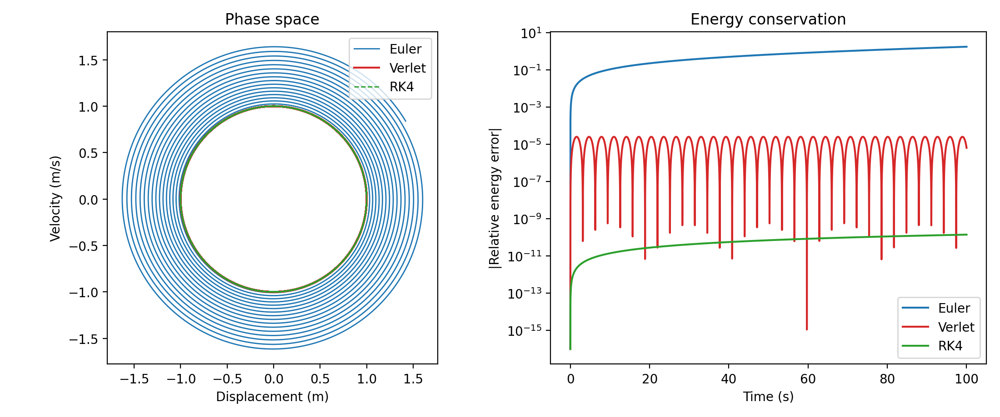

# Oscillation Simulators

Python programs that simulate oscillating systems, from simple harmonic
motion to chaotic (Duffing) oscillators, comparing numerical methods by
considering energy conservation.

## Result

Simple harmonic oscillator (m = 1 kg, k = 1 N/m, starting at 1 m, 100 s,
time step 0.01 s):

- **Euler:** energy grows by 172% and the phase-space orbit spirals outwards.
- **Verlet:** energy error stays below 2.5 × 10⁻⁵ and does not drift.
- **RK4:** energy error is about 1.4 × 10⁻¹⁰, but it grows slowly over time.

## Files

- `SHM.py`: analytical solution for undamped simple harmonic motion, with
  plots of position, velocity and kinetic, potential and total energy, and a
  check of the numerical energy against theory.
- `SHM_advanced.py`: analytical solutions for the damped oscillator
  (underdamped, critically damped and overdamped), with phase-space plots.
- `Numerical_Oscillator.py`: Euler, Verlet and Runge-Kutta 4 (RK4)
  integrators, run individually or compared, with relative energy error plots.
- `Forced_Oscillator.py`: driven, damped oscillators solved with RK4. The linear
  case gives resonance amplitude and phase against driving frequency. The
  nonlinear (Duffing) case gives phase space, a Poincaré section, a
  bifurcation diagram and a Lyapunov exponent map.
- `energy_error_comparison.png`: the figure above.
- `make_figure.py`: program that generates the figure.

## How to run

Requires Python with NumPy and Matplotlib.
To reproduce the figure above, run `python make_figure.py`.

`Forced_Oscillator.py` also saves its plots as PNG files in the same folder.
