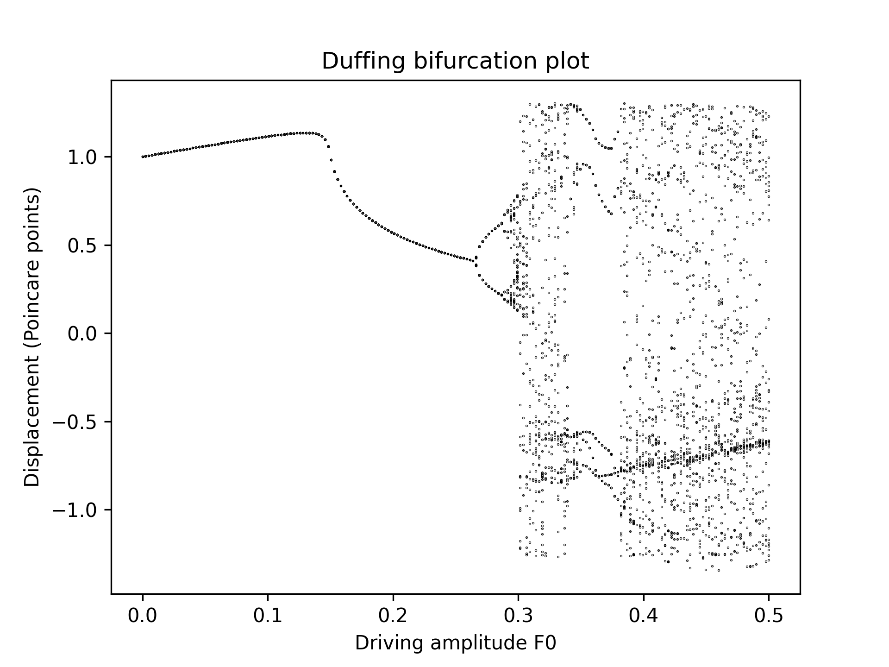
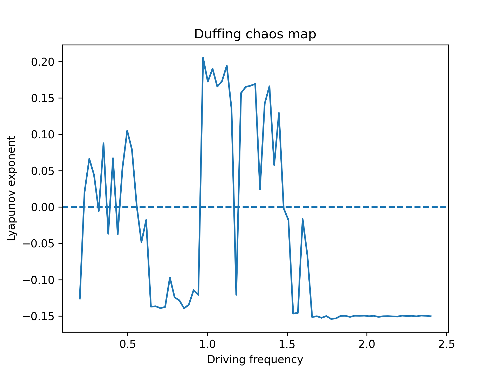
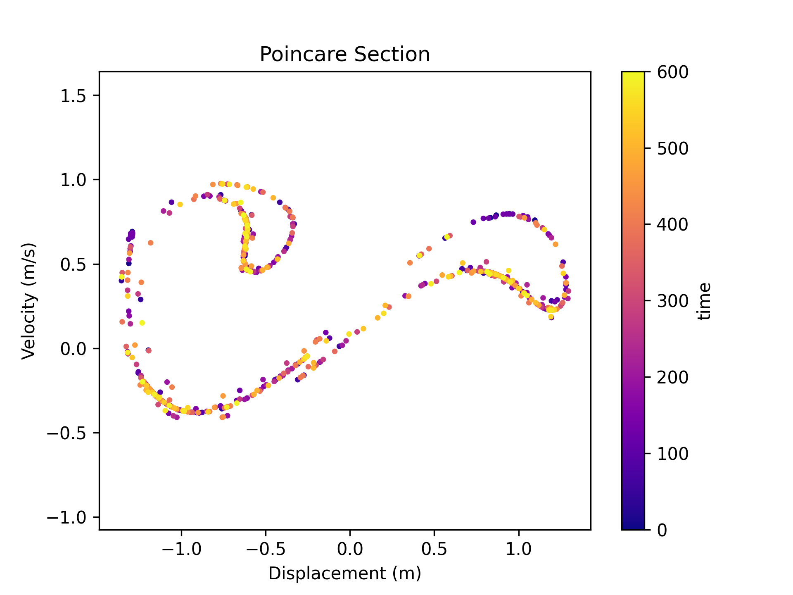

# Oscillation Simulators

Python programs that simulate oscillating systems, from simple harmonic
motion to a chaotic (Duffing) oscillator, comparing numerical methods by
considering energy conservation.

## Results

Simple harmonic oscillator (m = 1 kg, k = 1 N/m, starting at 1 m, 100 s,
time step 0.01 s):

- **Euler:** energy grows by 172% and the phase-space orbit spirals outwards.
- **Verlet:** energy error stays below 2.5 × 10⁻⁵ and does not drift.
- **RK4:** energy error is about 1.4 × 10⁻¹⁰, but it grows slowly over time.

## Chaos in the driven Duffing oscillator

`Forced_Oscillator.py` solves a damped, driven oscillator with a nonlinear
(x³) restoring force, using RK4. For a double-well potential driven at
ω = 1.2 (damping b = 0.3, x³ coefficient 1), the motion changes from regular
to chaotic as the driving amplitude F0 increases.

**Bifurcation diagram:** the long-term displacement, sampled once per driving
cycle, against driving amplitude. The response is a single steady cycle up to
F0 ≈ 0.27, then period-doubles, and becomes chaotic from F0 ≈ 0.30, with a
periodic window near F0 ≈ 0.35 to 0.37.

**Lyapunov exponent:** measures how quickly two nearly identical starting
points diverge. Positive values mean chaos. At F0 = 0.5 the exponent is
positive for driving frequencies from about 0.97 to 1.45 (+0.137 at ω = 1.2),
apart from isolated periodic windows. At high frequency it settles at -0.150,
equal to -b/2m, the rate expected from damping alone.

**Poincaré section:** the position and velocity sampled once per driving cycle
over 2000 cycles at F0 = 0.5, ω = 1.2. The points build up a folded, layered
structure typical of a chaotic (strange) attractor, instead of a few
points as in periodic motion.

## Files

- `SHM.py`: analytical solution for undamped simple harmonic motion, with
  plots of position, velocity and kinetic, potential and total energy, and a
  check of the numerical energy against theory.
- `SHM_advanced.py`: analytical solutions for the damped oscillator
  (underdamped, critically damped and overdamped), with phase-space plots.
- `Numerical_Oscillator.py`: Euler, Verlet and Runge-Kutta 4 (RK4)
  integrators, run individually or compared, with relative energy error plots.
- `Forced_Oscillator.py`: driven, damped oscillators solved with RK4. The linear
  case gives resonance amplitude and phase against driving frequency. The
  nonlinear (Duffing) case gives phase space, a Poincaré section, a
  bifurcation diagram and a Lyapunov exponent map. For the Duffing case the
  time step is adjusted so that one driving period is a whole number of steps,
  which keeps the once-per-cycle sampling exact.
- `make_figure.py`: program that generates the energy comparison figure.
- `make_duffing_figures.py`: program that generates the Duffing figures.
- `energy_error_comparison.png`, `bifurcation.png`, `chaos_map.png`,
  `poincare.png`: the figures shown above.

## How to run

Requires Python with NumPy and Matplotlib.

Run any program with `python filename.py` and enter the values when prompted.
To reproduce the figures above, run `python make_figure.py` and
`python make_duffing_figures.py` (the second script takes about a minute).

`Forced_Oscillator.py` also saves its plots as PNG files in the same folder.
